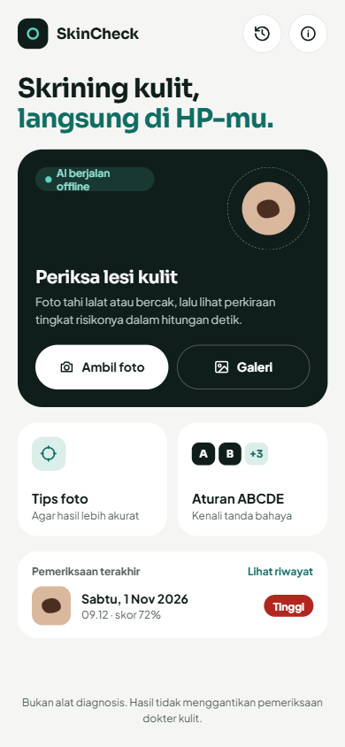
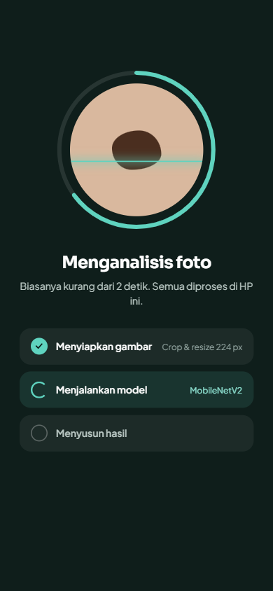
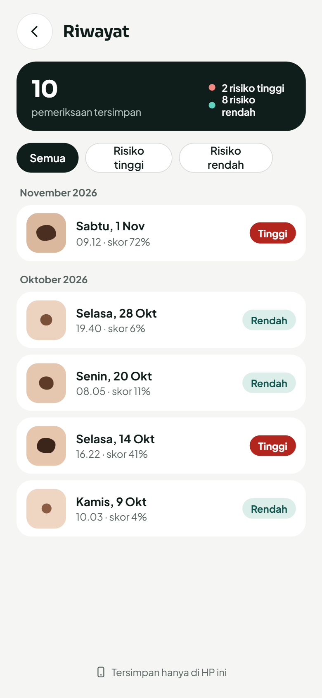
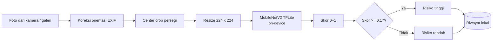

<div align="center">

# SkinCheck

**Aplikasi Android untuk skrining awal lesi kulit menggunakan MobileNetV2 yang berjalan sepenuhnya di perangkat (offline).**


</div>

---

## Daftar isi

- [Tentang proyek](#tentang-proyek)
- [Tampilan aplikasi](#tampilan-aplikasi)
- [Fitur](#fitur)
- [Cara kerja](#cara-kerja)
- [Model dan evaluasi](#model-dan-evaluasi)
- [Keterbatasan](#keterbatasan)
- [Teknologi](#teknologi)
- [Struktur proyek](#struktur-proyek)
- [Menjalankan proyek](#menjalankan-proyek)
- [Troubleshooting](#troubleshooting)
- [Melatih ulang model](#melatih-ulang-model)
- [Rencana pengembangan](#rencana-pengembangan)
- [Kredit dan lisensi](#kredit-dan-lisensi)
- [Tim](#tim)

---

## Tentang proyek

SkinCheck membantu pengguna melakukan **skrining awal** terhadap tahi lalat atau bercak kulit. Pengguna memotret lesi (atau memilih foto dari galeri), lalu aplikasi menampilkan **skor indikasi keganasan** dan tingkat risikonya: **rendah** atau **tinggi**.

Tiga prinsip yang dipegang:

| Prinsip | Penerapan |
|---|---|
| **Privasi** | Model berjalan *on-device*. Foto dan riwayat hanya disimpan di HP pengguna. Tidak ada server, tidak ada login. |
| **Mengutamakan keselamatan** | Ambang keputusan diturunkan ke **0,17** agar kanker lebih jarang terlewat, dengan konsekuensi lebih banyak alarm palsu. |
| **Transparan** | Ambang risiko, skor, dan keterbatasan model ditampilkan langsung di aplikasi. |

---

## Tampilan aplikasi

<!-- Sesuaikan nama file dengan isi folder design/ -->
| Beranda | Menganalisis | Hasil: risiko tinggi | Hasil: risiko rendah |
|:---:|:---:|:---:|:---:|
|  |  |  |  |

| Tips foto | Edukasi ABCDE | Riwayat | Detail riwayat |
|:---:|:---:|:---:|:---:|
|  |  |  |  |

Spesifikasi desain lengkap (warna, tipografi, komponen, dan tiap layar) ada di [`design/DESIGN.md`](design/DESIGN.md).

---

## Fitur

- **Ambil foto atau pilih dari galeri** menggunakan kamera bawaan perangkat.
- **Analisis on-device** dengan model MobileNetV2 (TensorFlow Lite), tanpa koneksi internet.
- **Skor indikasi keganasan** dalam bentuk cincin persentase, lengkap dengan penanda ambang 17%.
- **Penanda area analisis** yang menunjukkan bagian tengah foto yang benar-benar dinilai model.
- **Riwayat lokal**: setiap hasil tersimpan otomatis di HP, bisa dilihat detailnya dan dihapus.
- **Edukasi ABCDE** untuk mengenali tanda bahaya melanoma.
- **Tips foto** agar hasil analisis lebih konsisten.

---

## Cara kerja



Detail penting:

- **Preprocessing ada di dalam model.** Layer `Rescaling` (0–255 → −1…1) disertakan di graf model saat training. Aplikasi cukup mengirim piksel RGB mentah 0–255, sehingga tidak ada risiko normalisasi yang berbeda antara Python dan Dart.
- **Center crop**, bukan *stretch*, agar bentuk lesi tidak terdistorsi. Bentuk lesi adalah salah satu ciri penting (Asymmetry dan Border pada aturan ABCDE).
- **Preprocessing berjalan di isolate terpisah** (`compute()`) supaya antarmuka tidak tersendat.
- **Riwayat** disimpan sebagai file `history.json` di direktori dokumen aplikasi. Foto disalin ke folder `checks/` milik aplikasi, karena file dari `image_picker` berada di cache yang bisa dihapus sistem.

---

## Model dan evaluasi

### Data
- **Dataset:** [Skin Cancer: Malignant vs. Benign](https://www.kaggle.com/datasets/fanconic/skin-cancer-malignant-vs-benign) (Kaggle), berisi citra dermoskopi hasil olahan dari ISIC Archive, ukuran 224 × 224.
- **Kelas:** `benign` (0) dan `malignant` (1).
- **Pembagian:** folder `train` dibagi 80% latih / 20% validasi. Folder `test` (360 benign, 300 malignant) **hanya** dipakai untuk evaluasi akhir.

### Pelatihan
| Komponen | Pengaturan |
|---|---|
| Arsitektur | MobileNetV2 pretrained ImageNet + Dropout 0,3 + Dense sigmoid |
| Tahap 1 | Base dibekukan, Adam lr 1e-3, maks. 15 epoch |
| Tahap 2 | Fine-tune 30 layer terakhir (BatchNorm tetap beku), Adam lr 1e-5, maks. 10 epoch |
| Augmentasi | Flip, rotasi, zoom, brightness, contrast (hanya data latih) |
| Lainnya | Class weight, EarlyStopping (`val_auc`), ReduceLROnPlateau |
| Ekspor | TFLite float16, ±4,4 MB |

### Hasil pada test set (660 citra)

**ROC-AUC: 0,939**

| Metrik | Threshold 0,50 | Threshold 0,17 (dipakai) |
|---|---:|---:|
| Recall malignant (sensitivitas) | 82,0% | **94,3%** |
| Recall benign (spesifisitas) | 89,2% | 74,4% |
| Precision malignant | 86,3% | 75,5% |
| Accuracy | 85,9% | 83,5% |
| Kanker terlewat (FN) | 54 / 300 | **17 / 300** |
| Alarm palsu (FP) | 39 / 360 | 92 / 360 |

### Kenapa threshold 0,17?

Untuk skrining kanker, **melewatkan kanker jauh lebih berbahaya daripada alarm palsu**. Threshold dipilih dari **data validasi** (bukan test set) dengan target recall malignant ≥ 90%. Pada data validasi, threshold 0,17 menghasilkan recall 90,7% dengan false positive rate 23,6%. Hasil pada test set (recall 94,3%, FPR 25,6%) konsisten, yang menunjukkan threshold tidak *overfit* ke data validasi.

Konsekuensinya: sekitar **1 dari 4 lesi jinak akan ditandai risiko tinggi**. Ini keputusan yang disengaja.

---

## Keterbatasan


1. **Perbedaan domain (*domain shift*).** Model dilatih dengan **foto dermoskopi** (alat pembesar khusus, pencahayaan merata, lesi memenuhi frame), sedangkan aplikasi menerima **foto kamera HP biasa**. 
2. **Kemungkinan kebocoran data.** Dataset tidak menyertakan ID pasien atau lesi, sehingga tidak bisa dipastikan bahwa lesi yang sama tidak muncul di data latih dan data uji. Angka evaluasi bisa sedikit terlalu optimistis.
3. **Kanker masih bisa terlewat.** Pada test set, 17 dari 300 lesi ganas tetap terlewat. Hasil "risiko rendah" **bukan** jaminan lesi jinak.
4. **Klasifikasi biner.** Model hanya membedakan jinak vs. ganas, tidak mengenali jenis lesi spesifik dan tidak mendeteksi lokasi lesi di foto.
5. **Riwayat bersifat lokal.** Data hilang jika aplikasi dihapus atau data aplikasi dibersihkan.

---

## Teknologi

| Bagian | Teknologi |
|---|---|
| Aplikasi | Flutter 3.47, Dart |
| Inferensi | [`tflite_flutter`](https://pub.dev/packages/tflite_flutter) |
| Pengolahan citra | [`image`](https://pub.dev/packages/image) |
| Kamera & galeri | [`image_picker`](https://pub.dev/packages/image_picker) |
| Penyimpanan lokal | [`path_provider`](https://pub.dev/packages/path_provider) + JSON |
| Pelatihan model | TensorFlow / Keras, Google Colab (GPU T4) |

---

## Struktur proyek

```
SkinCheck/
├── assets/
│   └── skin_cancer.tflite          # Model MobileNetV2 (float16)
├── design/                         # Gambar acuan UI 
├── lib/
│   ├── main.dart
│   ├── classifier.dart             # Muat model, preprocessing, inferensi, threshold
│   ├── theme.dart                  # Token warna & tipografi
│   ├── id_date.dart                # Format tanggal bahasa Indonesia
│   ├── models/
│   │   └── check_record.dart       # Data satu pemeriksaan
│   ├── services/
│   │   └── history_store.dart      # Simpan/baca/hapus riwayat lokal
│   ├── screens/
│   │   ├── home_screen.dart
│   │   ├── photo_tips_screen.dart
│   │   ├── analyzing_screen.dart
│   │   ├── result_screen.dart
│   │   ├── abcde_screen.dart
│   │   ├── history_screen.dart
│   │   └── history_detail_screen.dart
│   └── widgets/
│       ├── score_ring.dart         # Cincin skor + penanda ambang
│       ├── risk_badge.dart         # Label risiko
│       └── crop_overlay.dart       # Penanda area yang dianalisis
└── android/
```

---

## Menjalankan proyek

### Prasyarat
- Flutter SDK 3.47 atau lebih baru (`flutter doctor` harus menunjukkan **Android toolchain ✓**)
- Android SDK beserta NDK (dipasang lewat Android Studio → SDK Manager)
- Perangkat Android **8.0 (API 26) atau lebih baru**, sesuai persyaratan `tflite_flutter`
- **Windows:** aktifkan **Developer Mode** (`start ms-settings:developers`). Plugin Flutter membutuhkan dukungan *symlink*.

### Langkah
```bash
git clone https://github.com/cindyfaizanabila/SkinCheck.git
cd SkinCheck
flutter pub get
flutter devices          # pastikan HP/emulator Android terdeteksi
flutter run              # build pertama bisa 5–15 menit
```

Membuat APK:
```bash
flutter build apk --release
# hasil: build/app/outputs/flutter-apk/app-release.apk
```

---

## Troubleshooting

Masalah yang kami temui saat setup, beserta solusinya.

<details>
<summary><b><code>Inconsistent JVM-target compatibility</code> pada <code>:tflite_flutter:compileDebugKotlin</code></b></summary>

**Penyebab:** plugin `tflite_flutter` mengatur Java ke versi 11, tetapi tidak mengatur target Kotlin. Kotlin pun mengikuti versi JDK yang menjalankan Gradle (misalnya JDK 25 bawaan Android Studio terbaru), sehingga keduanya tidak cocok.

**Solusi (sudah diterapkan di repo ini):** `android/build.gradle.kts` menyamakan Java dan Kotlin ke **17** untuk semua modul plugin. Sisi Java diatur lewat `finalizeDsl`, karena hanya di tahap itu nilainya tidak tertimpa script milik plugin.
</details>

<details>
<summary><b><code>Android sdkmanager did not install NDK ...</code></b></summary>

**Penyebab:** Gradle gagal mengunduh NDK secara otomatis lewat `sdkmanager`, yang pada versi terbaru sudah digantikan Android CLI.

**Solusi:** pasang NDK secara manual. Buka Android Studio → **SDK Manager → SDK Tools**, centang **Show Package Details**, lalu pilih versi NDK yang disebut di pesan error.
</details>

<details>
<summary><b><code>Building with plugins requires symlink support</code> (Windows)</b></summary>

Aktifkan Developer Mode: `start ms-settings:developers` → nyalakan **Developer Mode**.
</details>

<details>
<summary><b>HP tidak muncul di <code>flutter devices</code></b></summary>

1. Aktifkan **USB debugging** di Developer options, lalu tekan **Allow** pada pop-up di HP.
2. Gunakan kabel data (bukan kabel khusus charging) dan pilih mode USB **File transfer**.
3. Jika tetap tidak terdeteksi, pasang **Google USB Driver** (SDK Manager → SDK Tools) lalu perbarui driver lewat Device Manager.
4. Merek tertentu (Xiaomi, Vivo, OPPO) membutuhkan opsi tambahan seperti **Install via USB**.
</details>

---

## Melatih ulang model

https://colab.research.google.com/drive/1Y7XIMSuZiTw0RhoJRnuinMZW0Mc8RXp2
Langkah singkatnya:

1. Buka di Google Colab dan pilih runtime **T4 GPU**.
2. Jalankan semua cell. Dataset diunduh otomatis melalui `kagglehub`.
3. Unduh `skin_cancer.tflite` dan `threshold.txt` hasil ekspor.
4. Ganti `assets/skin_cancer.tflite`, lalu perbarui `highRiskThreshold` di `lib/classifier.dart` sesuai `threshold.txt`.
5. **Lakukan tes kesamaan skor:** bandingkan skor beberapa gambar dari folder `test/` di Colab dan di aplikasi. Selisihnya harus sangat kecil (< 0,02).

---

## Rencana pengembangan

- [ ] Fine-tune dengan citra kamera HP, misalnya [PAD-UFES-20](https://data.mendeley.com/datasets/zr7vgbcyr2/1), untuk mengurangi *domain shift*.
- [ ] Evaluasi pada foto HP berlabel dengan pembagian data per pasien.
- [ ] Output tiga tingkat (rendah / perlu dipantau / tinggi) untuk menyampaikan ketidakpastian model dengan lebih jujur.
- [ ] Fitur hapus semua riwayat dan ekspor riwayat untuk dibawa ke dokter.
- [ ] Mengganti `applicationId` bawaan (`com.example.skin_check`).

---

## Kredit dan lisensi

**Dataset**
- *Skin Cancer: Malignant vs. Benign*, oleh fanconic di Kaggle, berupa citra olahan dari **ISIC Archive** (International Skin Imaging Collaboration).
- Penggunaan dataset dan model turunannya mengikuti ketentuan lisensi pada halaman dataset Kaggle dan ISIC Archive. Sebagian data ISIC berlisensi **non-komersial**, sehingga file `assets/skin_cancer.tflite` **tidak** untuk penggunaan komersial.
